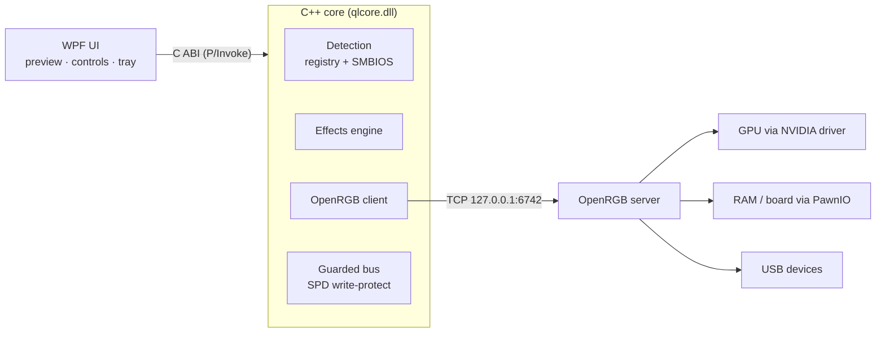

<div align="center">

# ✨ Quasar Light

**One lightweight, open-source control panel for everything on your PC that glows.**
Graphics card · RAM · motherboard · and any other device [OpenRGB](https://openrgb.org) can drive.


<sub>Live preview of the GPU, RAM and board lighting with a hardware status badge on every device.</sub>

</div>

---

## Why Quasar Light

Every vendor ships its own heavy RGB suite and they fight over the same hardware. Quasar Light is a **single small utility**:
detects your GPU, RAM and motherboard, shows a live animated preview, and sends the effect to the real hardware.

- 🔍 **Auto-detection** of GPU (name, VRAM, driver), RAM modules (slot, maker, part, speed) and motherboard, no driver needed
- 🎨 **6 effects** computed by a C++ engine: Static, Breathing, Rainbow Wave, Spectrum Cycle, Comet, Sparkle, plus colour, speed, brightness, direction
- 🔌 **Real hardware control** through OpenRGB, with a green **LIVE** badge on every linked device
- 🧩 **Any other OpenRGB device** (keyboards, mice, strips, coolers…) appears automatically as its own card
- 🖼️ **Your own photo** for each device (*Set image…*), shown with a glow that follows the effect
- 🛡️ **Safety first**: memory and board are only ever driven through OpenRGB; *Restore* puts the original mode back
- 🧷 Tray icon, single instance, settings in `%APPDATA%\QuasarLight\settings.json`, no telemetry

## Install

1. Download **`QuasarLight-<version>-win-x64.zip`** from the [Releases](../../releases) page and unzip it anywhere.
   *No .NET install needed.*
2. Run **`QuasarLight.exe`** and accept the Windows **UAC** prompt (needed for memory and motherboard).
3. Press **Connect OpenRGB**. If OpenRGB is not installed, Quasar Light offers to download the official release
   and verifies its SHA-256 checksum before using it.
4. **Memory and motherboard only:** install the free **PawnIO** driver from [pawnio.eu](https://pawnio.eu)
   (there is a button in the app) and stop other RGB software, see below.
5. Pick an effect and press **Apply to hardware** (or tick *Auto-apply changes*).

> Graphics cards and USB devices work **without** PawnIO and without administrator rights.

## ⚠️ If something doesn't work, read this first

| Symptom | Cause and fix |
|---|---|
| **RAM / motherboard missing, or they don't change** | 1) Install **PawnIO** ([pawnio.eu](https://pawnio.eu)), then restart Quasar Light. 2) Run as administrator: accept the UAC prompt. 3) **Stop other RGB software** that holds the same bus (see next row). |
| **MSI Center / Mystic Light open or running** | Closing the window is not enough: **exit it from the tray and stop its services** in `services.msc`: `Mystic_Light_Service`, `MSI_Central_Service`. The same applies to **Armoury Crate / Aura**, **iCUE**, **Razer Synapse**, **NZXT CAM**, **SignalRGB**, **Gigabyte RGB Fusion / Aorus Engine**, **HyperX NGENUITY**, **Corsair/Kingston** tools. Two programs on one bus cause missing devices and flicker. |
| **GPU not listed or won't change** | Close vendor GPU RGB tools (Aorus Engine, Afterburner RGB, ROG GPU Tweak…). Check that the card is in OpenRGB's [supported list](https://openrgb.org): not every card is. Update the NVIDIA/AMD driver. |
| **"Connect OpenRGB" can't connect** | Another `OpenRGB.exe` may be running with different settings: end it in Task Manager and try again. OpenRGB's SDK server must listen on `127.0.0.1:6742` (loopback only). Allow it if your firewall asks. |
| **Windows SmartScreen warns about the exe** | The release is **not code-signed** yet. Click *More info → Run anyway*, or verify the SHA-256 from the release page. The full source is in this repo. |
| **Antivirus flags it** | Hardware-access drivers (PawnIO) and RGB tools are commonly flagged as false positives. Review the source or build it yourself. |
| **Effect looks different on the device** | Devices use their **built-in** modes. If one lacks an effect (e.g. Comet), Quasar Light shows the primary colour statically and says so in the status bar. |
| **Colour resets after reboot** | Many devices don't store a static colour. Re-apply after boot (autostart is on the roadmap). |
| **Still stuck?** | Check OpenRGB's log in `%APPDATA%\OpenRGB\logs`. Lines like `Permission Denied` mean not elevated; `Could not open PawnIO` means the driver is missing. Then [open an issue](../../issues) and attach the log, your GPU / RAM / board model. |

## What works today (honest status)

| Area | Status |
|---|---|
| Detection of GPU / RAM / board | ✅ implemented, tested on the author's PC |
| C++ core (effects, OpenRGB protocol, bus-safety layer) | ✅ 46 automated checks |
| OpenRGB 1.1 SDK client (protocol 3) | ✅ verified against a live server |
| Gigabyte GTX 1080 Ti Xtreme (no extra driver) | ✅ verified by the author |
| HyperX Predator RGB RAM + MSI MPG Z390 Gaming Plus (with PawnIO) | ✅ reported working by the author on one PC |
| Other hardware | ❔ works **if OpenRGB supports it**. Reports welcome |
| Autostart with Windows, profiles, per-LED editor | 🛠️ roadmap |

Quasar Light does **not** ship its own device protocols yet; it is a fast, clean front-end for OpenRGB's hardware support.

## How it works



More detail: [Architecture](docs/ARCHITECTURE.md) · [Safe bus scanning](docs/SAFE_SCANNING.md)

## Build from source

Requires Windows x64, **MSYS2 mingw64 `g++`** and **.NET SDK 10**.

```powershell
./package.ps1                     # core + tests + dist/QuasarLight-<version>-win-x64.zip
```

Development run (skips the UAC prompt, so GPU/USB only):

```powershell
./build-core.ps1
cd ui/QuasarLight.App
dotnet build -c Release -p:Platform=x64
./bin/x64/Release/net10.0-windows/QuasarLight.exe --no-elevate
```

## Roadmap

Autostart & tray-only mode · profiles · per-LED editor · native plugins for devices OpenRGB lacks · low-RAM background service · code signing.

<details>
<summary><b>🇷🇺 Коротко по-русски</b></summary>

**Quasar Light** показывает ваши видеокарту, память и плату, рисует живое превью подсветки и управляет реальным железом через OpenRGB.

**Установка:** скачайте zip из Releases → запустите `QuasarLight.exe` и подтвердите UAC → «Connect OpenRGB» (при необходимости приложение само скачает OpenRGB с проверкой хэша) → для памяти и платы поставьте драйвер **PawnIO** (pawnio.eu).

**Если не работает:** закройте и **остановите службы** других RGB-программ (MSI Center / Mystic Light: `Mystic_Light_Service`, `MSI_Central_Service`; Armoury Crate, iCUE, Synapse, SignalRGB и т. д.), запустите от администратора, установите PawnIO. Видеокарты и USB-устройства работают без PawnIO и без админ-прав. Подробности в таблице выше.
</details>

## License

MIT. [OpenRGB](https://openrgb.org) is GPL-2.0 and is used only as a separate process. PawnIO is a separate driver by its authors.
