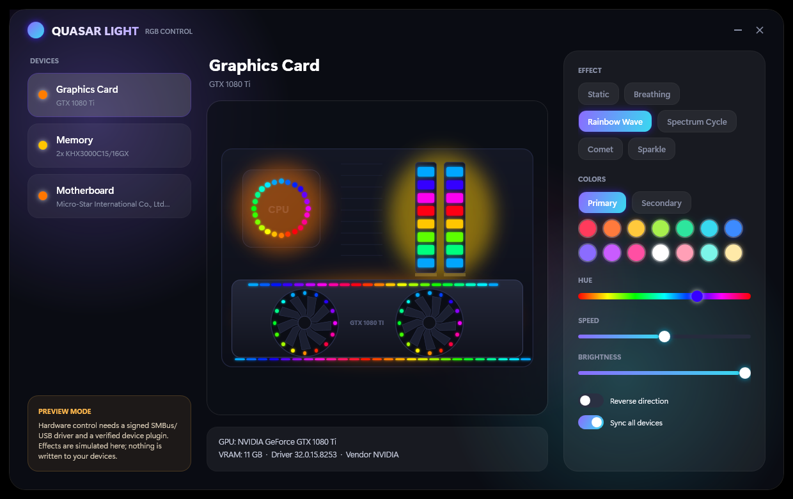

# ✨ Quasar Light

One lightweight, open-source place to see and (eventually) control everything on your PC that glows.

<p align="center"></p>

<sub>Screenshot of the real app running on the developer's PC (GTX 1080 Ti, 2× Kingston KHX3000C15, MSI MPG Z390). The glow is an in-app **preview**.</sub>

## What works today

- Detects **GPU** (name, 64-bit VRAM, driver, vendor), **RAM modules** (slot, maker, part, size, type, speed) and **motherboard** — no kernel driver needed.
- Live animated preview of the GPU (spinning fans, ring + edge LEDs), RAM sticks and board lighting.
- 6 effects from the C++ engine: Static, Breathing, Rainbow Wave, Spectrum Cycle, Comet, Sparkle; colours, hue, speed, brightness, reverse, sync-all.
- Tray icon with quick effect switch, single instance, settings saved to `%APPDATA%\QuasarLight\settings.json`.
- Safety layer for bus access (SPD/PMIC write protection, write grants, audit log) tested on a simulated SMBus.

## What does NOT work yet

**It does not change the real LEDs.** That needs a signed SMBus/I²C driver and per-vendor plugins verified on hardware. The UI states "Preview mode". See [docs/SAFE_SCANNING.md](docs/SAFE_SCANNING.md).

## Build (Windows x64)

Requires: MSYS2 mingw64 `g++` (for the core DLL), .NET SDK 10.

```powershell
./build-core.ps1                                   # builds qlcore.dll, runs 35 core checks
cd ui/QuasarLight.App
dotnet build -c Release -p:Platform=x64
./bin/x64/Release/net10.0-windows/QuasarLight.exe
```

## Docs
[Architecture](docs/ARCHITECTURE.md) · [Safe scanning](docs/SAFE_SCANNING.md)

## License
MIT
